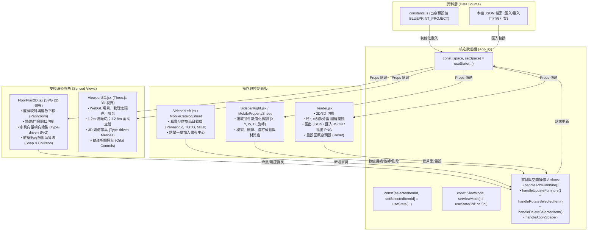

# 空間規劃師 (Floorplan Taste) 架構設計與運作模式白皮書

> 本文件詳細說明 `floorplan-taste` 空間規劃系統的核心設計理念、狀態管理模式、2D/3D 渲染管線、使用者操作邏輯，以及開發者修改代碼與使用者前端操作之間的本質差異。

---

## 一、 核心疑問解答

### Q1：為什麼這次調整擺放位置會動到 `.js` 與 `.jsx`？

這次調整之所以修改了 `constants.js` 以及 `FloorPlan2D.jsx` / `Viewport3D.jsx`，原因在於**「出廠預設模板（Factory Blueprint）」**與**「語義化擬真渲染（Semantic Rendering）」**的定位：

#### 1. 修改 `constants.js` 的原因：修正「出廠預設基準」
- `floorplan-taste` 是一個以 React 構建的單頁應用程式（SPA）。當任何使用者首次開啟網頁、點擊頂部「★ 本案預設 (三分離衛浴)」按鈕、或重新整理瀏覽器時，應用程式的初始狀態是**直接深拷貝**自 `constants.js` 中的 `BLUEPRINT_PROJECT` 常數。
- 先前大門標示位置偏離、以及沙發三件套與電視軸向不一致，屬於**專案模板的原始設定缺陷**。
- 如果我們僅在瀏覽器前端透過滑鼠拖曳調整，使用者的當前畫面固然改變了，但一旦按下「重新整理」或「重設戶型」，錯誤的初始配置又會重新被載入。因此，要讓所有連上 Cloudflare Tunnel 網址的使用者都能看到正確的標準配置，必須修改 `constants.js` 作為永久出廠設定。

#### 2. 修改 `.jsx` (`FloorPlan2D.jsx` / `Viewport3D.jsx`) 的原因：提供「方向特徵與擬真外觀」
- 如果家具只是單純的「無方向性色塊（純矩形）」，在平面圖與 3D 視界中根本看不出電視螢幕究竟朝東還是朝西、沙發靠背朝哪裡、免治馬桶的噴嘴與水箱朝哪、洗衣機門朝哪個方向開啟。
- 先前使用者明確指出：*「沙發三件套跟電視是完全不同方向」、「裡面的置入元件都要找到真實商品的真實數據，不是說要放這裡就可以放這裡」*。
- 為了讓使用者一眼就能識別家具的**「朝向與開合方向」**，我們在：
  - **`FloorPlan2D.jsx`**：為特定 `type`（如 `sofa`, `armchair`, `tv`, `tvstand`, `toilet_wash_tank`, `washer` 等）增加了具備方向識別特徵的 SVG 語義圖元（繪製出沙發靠背與扶手、電視螢幕發光線、水箱凹槽洗手盆、滾筒玻璃門）。
  - **`Viewport3D.jsx`**：在 Three.js 中為對應 `type` 建立專屬立體模型（電視 OLED 發光螢幕與底座、MUJI 羽絨三人沙發座墊靠背、Karimoku 木質扶手單椅）。
- 若不修改 `.jsx` 擴充這些專屬類型的渲染分支，系統在遇到未知家具時，就只會退化為渲染一個均勻無朝向的預設方塊（`else { const boxGeo = new THREE.BoxGeometry(...) }`）。

---

### Q2：如果 User 在前端手動調整 / 增加 / 刪除格局或家具，該怎麼辦？

**使用者完全不需要動到任何程式碼！前端 UI 本身就具備完整的可視化操作與資料儲存機制：**

```
┌─────────────────────────────────────────────────────────────────┐
│                      使用者可視化操作體系                        │
├─────────────────┬───────────────────────────────────────────────┤
│ 1. 家具位置拖曳  │ 在 2D 畫布上滑鼠長按拖曳，具備「避牆吸附演算法」│
│ 2. 角度旋轉     │ 選取家具後按鍵盤 R 鍵，或在屬性面板精確旋轉   │
│ 3. 尺寸與外觀   │ 右側屬性面板可自訂 W (寬)、D (深)、名稱與顏色 │
│ 4. 新增家具庫   │ 點擊左側真實商品庫（Panasonic、TOTO、MUJI...）│
│ 5. 複製與刪除   │ 屬性面板提供一鍵「複製」、「刪除」            │
│ 6. 專案存檔匯出 │ 頂部「匯出」：下載包含全配置的 *.json 檔案    │
│ 7. 專案載入還原 │ 頂部「匯入」：上傳任何已儲存的 *.json 立即還原│
│ 8. 平面施工圖   │ 頂部「圖片」：一鍵輸出 2400px 高畫質尺寸圖     │
└─────────────────┴───────────────────────────────────────────────┘
```

#### 資料持久化流程（Persistence Flow）
1. **執行時修改**：使用者在畫面上的任何拖曳、新增、旋轉，都會即時更新 React 的 `space` 狀態（以 `uuid` 識別各構件）。
2. **本機保存**：使用者點擊頂部導航列的 **「匯出」** 按鈕，系統會將記憶體中的 `space` 狀態序列化為標準 JSON 檔案（例如 `本案長條複層戶型_設計專案.json`）並下載至本機電腦。
3. **還原載入**：未來任何時候打開此網址，點擊 **「匯入」** 按鈕並選擇該 JSON 檔案，系統的 `handleImportJson` 會立即讀取檔案並執行 `setSpace(parsed)`，完整還原使用者當時自訂的所有家具座標、旋轉角與格局！

---

## 二、 系統架構與資料流向 (Architecture & Data Flow)

`floorplan-taste` 採用經典的 **單向資料流 (Unidirectional Data Flow)** 架構，狀態由最頂層的 `App.jsx` 集中管控，並向下分發給 2D 向量畫布與 3D WebGL 引擎：



---

## 三、 核心資料模型 (Data Schema)

整個空間規劃系統的骨幹是一個純 JSON 相容的 `Space` 物件：

```typescript
interface SpaceProject {
  id: string;              // 專案唯一標識 (如 "blueprint_teg_long_house")
  name: string;            // 專案名稱
  length: number;          // 空間總長度 (X軸，單位：mm，本案為 19250)
  width: number;           // 空間總寬度 (Y軸，單位：mm，本案為 4810)
  height: number;          // 室內淨高 (Z軸，單位：mm，本案為 2800)
  scale: number;           // 顯示縮放比例標準 (預設 1)
  wallThickness: number;   // 標準牆體厚度 (預設 150mm)

  // 1. 機能分區
  rooms: Array<{
    id: string;            // 分區 ID (如 "room_master")
    name: string;          // 區域名稱 (如 "獨立主臥室")
    x: number;             // 區域起點 X (mm)
    y: number;             // 區域起點 Y (mm)
    w: number;             // 區域寬度 (mm)
    h: number;             // 區域高度 (mm)
    color: string;         // 底色標籤 (如 "#fef3c7")
    floorMaterial?: string;// 地板材質 ("wood_herringbone" | "tile_marble" | ...)
  }>;

  // 2. 隔間牆體結構
  walls: Array<{
    id: string;
    type: 'exterior' | 'interior'; // 外牆或室內隔間
    x1: number; y1: number;        // 起點坐標 (mm)
    x2: number; y2: number;        // 終點坐標 (mm)
    thickness: number;             // 牆厚 (通常 150mm)
  }>;

  // 3. 門扇與出入口
  doors: Array<{
    id: string;
    name: string;
    wall: 'top' | 'bottom' | 'left' | 'right' | 'interior';
    x1: number; y1: number;        // 門洞起點
    x2: number; y2: number;        // 門洞終點
    width: number;                 // 門淨寬 (通常 800~900mm)
    swing: 'left' | 'right';       // 開門方向 (弧線朝向)
    type: 'single' | 'sliding';    // 掩門或橫拉門
  }>;

  // 4. 窗戶採光口
  windows: Array<{
    id: string;
    wall: 'top' | 'bottom' | 'left' | 'right';
    x1: number; y1: number;
    x2: number; y2: number;
    elevation: number;            // 窗台高度 (mm)
    height: number;               // 窗高 (mm)
  }>;

  // 5. 家具與衛生設備 (核心動態項目)
  furniture: Array<{
    id: string;                   // 唯一 ID (如 "f_sofa")
    type: string;                 // 元件類型 (對應渲染器分支，如 "sofa", "bed", "toilet")
    name: string;                 // 顯示品名 (如 "無印良品 羽絨三人沙發")
    cx: number;                   // 中心點 X 坐標 (mm)
    cy: number;                   // 中心點 Y 坐標 (mm)
    w: number;                    // 實物寬度 (mm)
    d: number;                    // 實物深度 (mm)
    rot: number;                  // 旋轉角度 (0, 90, 180, 270 度)
    color?: string;               // 顯示主色調
    brand?: string;               // 真實品牌 (如 "MUJI", "Simmons", "TOTO")
    model?: string;               // 商品型號
  }>;

  // 6. 原水管與排污定位 (工務保留點)
  waterSupply: Array<{
    id: string;
    name: string;
    cx: number; cy: number;
    type: 'sewage' | 'drain' | 'water_in';
  }>;
}
```

---

## 四、 2D 與 3D 渲染與互動運作機制

### 1. 2D 平面圖向量渲染器 (`FloorPlan2D.jsx`)
- **世界座標系與 ViewBox 映射**：
  以毫米（mm）為絕對單位，$X$ 軸由左至右（$0 \to 19250\text{ mm}$），$Y$ 軸由上至下（$0 \to 4810\text{ mm}$）。
  ViewBox 依據動態的 `viewCenter` 與 `zoom` 即時計算，支援：
  - 自由平移（滑鼠左鍵空白處拖曳、或手機單指滑動）。
  - 無段縮放（滑鼠滾輪、或手機雙指捏合 Pinch-to-zoom）。
- **智能避牆與吸附演算法 (`clampFurniturePosition`)**：
  當使用者在畫布上拖曳家具時，引擎會依據當前旋轉角度動態計算家具的包圍盒（Bounding Box 半寬與半深），將家具坐標限制在室內可用淨空間內，防止家具被誤拖出建築外牆或直接跨壓在主要實體結構牆上。
- **旋轉座標轉換**：
  在 SVG 中，每個家具節點均以自身中心點為旋轉錨點：
  `<g transform="translate(cx, cy) rotate(rot)">`，這保證了無論旋轉角度為何，家具始終以幾何中心原地旋轉，不會產生離心平移偏差。

### 2. 3D WebGL 擬真空間 (`Viewport3D.jsx`)
- **單位尺度映射**：
  Three.js 場景以米（m）為基準單位：
  $$\text{Unit}_{\text{3D}} = \frac{\text{Coordinate}_{\text{mm}}}{1000}$$
- **多視角鏡頭與光影**：
  - **45° 鳥瞰視角 (Bird's Eye)**：全局俯瞰建築透視，直觀感受三分離衛浴、客廳、主臥的空間比例。
  - **90° 正頂部視角 (Top Down)**：等角平面檢視，方便審查走道淨寬與家具對齊。
  - **物理陽光與陰影**：配置 `DirectionalLight` (太陽光源) 與 `HemisphereLight` (環境天空漫射)，搭配 `PCFSoftShadowMap` 產生精確的陰影落點。
- **雙模式剖切切換**：
  - `low` 模式：隔間牆自動切至 $1.2\text{ m}$ 高度，視線不受高牆遮蔽，一目了然看穿全室動線。
  - `full` 模式：牆體還原為 $2.8\text{ m}$ 完整淨高，呈現真實空間閉合感。

---

## 五、 室內隔間自由編輯與瀏覽器持久化 (已全面實作)

系統現已正式支援**「承重結構鎖定」**與**「室內輕隔間牆自由編輯與本地持久化」**機制：

### 1. 承重結構鎖定保護 (Locked Structural Elements)
依照建築法規與結構安全規範，以下構件設為永久鎖定，不可被選取移動或拆除：
- **四面外牆 (`type: 'e'`)**：北外牆、南外牆、東落地大窗牆、西外牆。
- **承重柱與剪力結構 (`type: 'b'`)**：四角角端承重柱，在平面圖以專用 45° 鋼筋混凝土斜線網紋 (`bearing-hatch`) 標記。
- **窗戶與採光口 (`windows`)**：固定於外牆結構。
- **主要入戶大門 (`d_entry`)**：鎖定於下樓樓梯旁外牆位置。
- **雙向折返梯 (`stairs`)**：建築原結構既有梯間。

### 2. 室內輕隔間牆自由編輯體系 (Moveable Partitions)
所有室內非承重隔間牆 (`type: 'n'`) 均支援全套可視化與數值化操作：
- **點擊選取與視覺熱區**：具備加大 60px 的點擊熱區，滑鼠懸停顯示平移指標（垂直牆 `col-resize`、水平牆 `row-resize`），選中時顯示亮橘色輪廓與標籤徽章。
- **畫布拖曳平移**：滑鼠或觸控按住牆體即可平滑拖曳，內建 50mm 網格吸附。
- **門扇連動機制 (Door Linkage)**：開在該道隔間牆上的門扇（如主臥門、客房門、洗面脫衣所門）會隨隔間牆同步平移，杜絕脫節。
- **數值化微調面板**：右側屬性面板提供精準座標輸入（$X$ 或 $Y$）、50mm 步進微調按鈕、厚度調整。
- **拆除隔間（一鍵打通）**：點擊「🗑 拆除/刪除此道隔間牆」，使用者可隨時拆掉客房或主臥隔間，自由改造成開放式大平層或大套房。
- **新增隔間牆**：工具箱隨時可點擊「＋ 縱向隔間牆」或「＋ 橫向隔間牆」置入新隔間。

### 3. 瀏覽器自動持久化 (Browser LocalStorage Sync)
- **免重複設定**：使用者在畫面上移動任何一件家具或隔間牆，系統均透過 `useEffect` 自動將最新空間數據序列化存入瀏覽器的 `localStorage` (`floorplan_user_space_v2`)。
- **重新整理不遺失**：下次關閉瀏覽器再次進入、或按下重新整理，頁面將優先載入使用者專屬的最新格局，不再強制回到出廠預設值。
- **出廠還原保障**：頂部導航列保留「★ 本案預設 (三分離衛浴)」按鈕，使用者若想重新開始，可一鍵覆蓋快取並重設回官方標準戶型。

---

*文件維護：Antigravity Agentic Architecture Team*  
*最新更新日期：2026 年 10 月*

